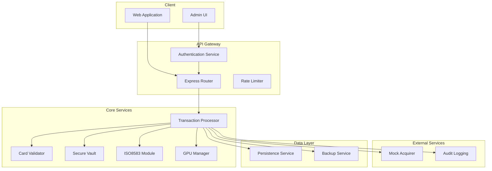
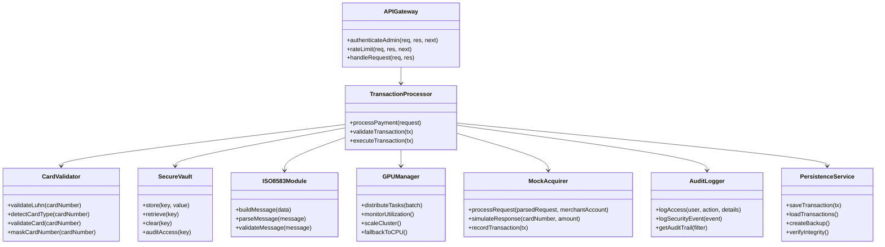
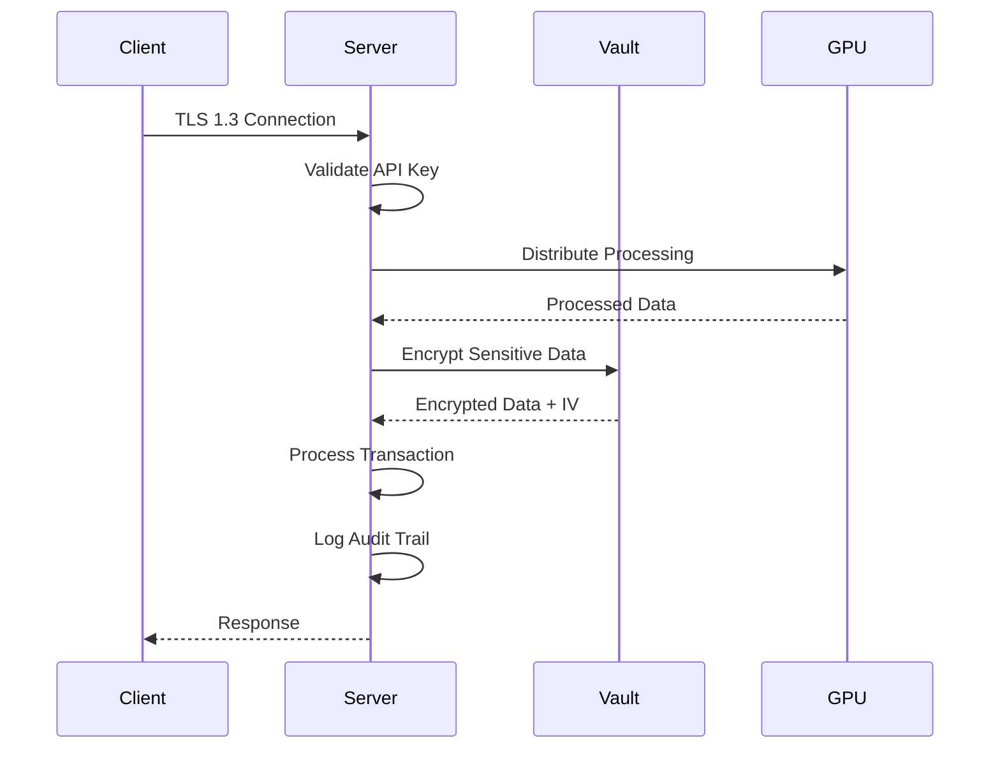
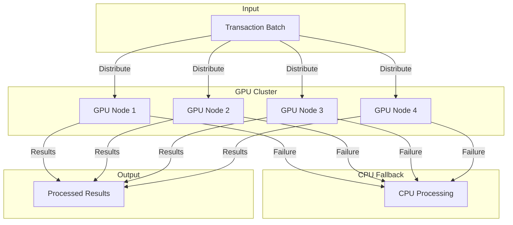

# Design Document: Payment Processor Security and Performance Enhancements

## Overview

This document outlines the design for implementing security enhancements and performance improvements for the payment processing system. The enhancements focus on achieving PCI-DSS compliance, implementing quantum-resistant encryption, adding GPU processing capabilities, and optimizing transaction performance.

The system is a Node.js application that handles payment transactions using ISO8583 message simulation, card validation, and secure data storage. This design addresses all 15 requirements from the requirements document, with particular attention to security architecture, performance optimization, and integration with the existing codebase.

## Architecture

### High-Level Architecture



### Component Diagram



## Components and Interfaces

### 1. Card Validator Enhancement

**Current Implementation**: `utils/cardValidator.js`

**Enhanced Interface**:
```javascript
class CardValidator {
    // Validation
    validateLuhn(cardNumber)
    detectCardType(cardNumber)
    validateCard(cardNumber)
    
    // Security
    maskCardNumber(cardNumber, visibleDigits = 4)
    isCardNumberValid(cardNumber)
    
    // Error Handling
    getCardValidationErrors(cardNumber)
}
```

**Key Changes**:
- Add card number masking for logs and responses
- Enhanced error reporting with specific error codes
- Support for PCI-DSS compliant card data handling

### 2. Secure Vault Enhancement

**Current Implementation**: `utils/secureVault.js`

**Enhanced Interface**:
```javascript
class SecureVault {
    // Core Operations
    store(key, value, options = {})
    retrieve(key)
    clear(key)
    
    // Security Features
    rotateKeys()
    auditAccess(key)
    setRetentionPolicy(key, duration)
    
    // FIPS 140-2 Compliance
    useFIPSCompliantAlgorithms()
    useCSPRNG()
}
```

**Key Changes**:
- Add key rotation support
- Implement audit logging for all access
- Add data retention policies
- Ensure FIPS 140-2 compliance

### 3. ISO8583 Module Enhancement

**Current Implementation**: `utils/isoSim.js`

**Enhanced Interface**:
```javascript
class ISO8583Module {
    // Message Building
    buildMessage(data)
    buildMessageFromObject(obj)
    
    // Message Parsing
    parseMessage(message)
    parseMessageToObject(message)
    
    // Validation
    validateMessage(message)
    validateRoundTrip(original, parsed)
    
    // Error Handling
    getParseErrors(message)
}
```

**Key Changes**:
- Implement proper round-trip consistency
- Add comprehensive validation
- Support for message versioning and migration

### 4. GPU Manager

**New Component**: `utils/gpuManager.js`

**Interface**:
```javascript
class GPUManager {
    // Task Distribution
    distributeTasks(batch)
    balanceLoad()
    
    // Monitoring
    monitorUtilization()
    getMetrics()
    
    // Scaling
    scaleCluster(up)
    getClusterSize()
    
    // Fallback
    fallbackToCPU()
    isGPUAvailable()
}
```

### 5. Authentication Service

**New Component**: `utils/authService.js`

**Interface**:
```javascript
class AuthService {
    // API Key Validation
    validateAPIKey(key)
    generateAPIKey()
    
    // Session Management
    createSession(user)
    validateSession(session)
    invalidateSession(session)
    
    // MFA
    initiateMFA(user)
    verifyMFA(user, code)
    
    // Access Control
    checkAccess(user, resource, action)
    getRoles(user)
}
```

### 6. Audit Logger

**New Component**: `utils/auditLogger.js`

**Interface**:
```javascript
class AuditLogger {
    // Logging
    logAccess(user, action, details)
    logSecurityEvent(event)
    logTransaction(tx)
    
    // Queries
    getAuditTrail(filter)
    getSecurityEvents(filter)
    getTransactionLogs(filter)
    
    // Compliance
    exportForAudit(format)
    getRetentionCompliance()
}
```

### 7. Performance Optimizer

**New Component**: `utils/performanceOptimizer.js`

**Interface**:
```javascript
class PerformanceOptimizer {
    // Caching
    cacheGet(key)
    cacheSet(key, value, ttl)
    cacheInvalidate(pattern)
    
    // Metrics
    measureOperation(name, fn)
    getMetrics()
    getBottlenecks()
    
    // Throttling
    throttle(request)
    isThrottled()
}
```

## Data Models

### Transaction Object
```javascript
{
    id: "TXN_1234567890123",
    cardType: "Visa",
    lastFour: "1234",
    amount: 99.99,
    currency: "USD",
    status: "Approved" | "Declined",
    responseCode: "00",
    settlementStatus: "Settled" | "Paid Out" | "N/A",
    merchantAccount: "ACT_9988776655",
    timestamp: "2024-01-15T10:30:00.000Z",
    mfaVerified: false,
    processingTimeMs: 450,
    gpuProcessed: true,
    securityFlags: {
        cardMasked: true,
        encrypted: true,
        auditLogged: true
    }
}
```

### ISO8583 Message Format
```
MTI:0200|F02:**** **** **** 1234|F04:0000009999|F07:20240115103000|F14:12/25|F49:840|F52:PRESENT
```

### Audit Log Entry
```javascript
{
    id: "AUDIT_1234567890123",
    timestamp: "2024-01-15T10:30:00.000Z",
    event: "access" | "security" | "transaction",
    user: "admin@example.com",
    action: "view_transactions" | "update_settings",
    details: {
        resource: "transactions",
        ip: "192.168.1.1",
        userAgent: "Mozilla/5.0..."
    },
    success: true,
    severity: "info" | "warning" | "error"
}
```

### GPU Processing Metrics
```javascript
{
    timestamp: "2024-01-15T10:30:00.000Z",
    clusterSize: 4,
    utilization: 0.75,
    tasksProcessed: 1500,
    avgProcessingTimeMs: 45,
    fallbackCount: 0,
    memoryUsage: {
        total: 16384,
        used: 12288
    }
}
```

## API Design

### Payment Processing API

**Endpoint**: `POST /api/process-payment`

**Request**:
```json
{
    "cardNumber": "4111111111111111",
    "expiryDate": "12/25",
    "cvv": "123",
    "amount": 99.99,
    "currency": "USD",
    "mfaVerified": false
}
```

**Response**:
```json
{
    "success": true,
    "message": "Success",
    "transactionId": "TXN_1234567890123",
    "status": "Approved",
    "processingTimeMs": 450,
    "gpuProcessed": true
}
```

### Admin API

**Endpoints**:
- `GET /api/transactions` - List all transactions
- `GET /api/transactions/:id` - Get specific transaction
- `GET /api/settings` - Get merchant settings
- `POST /api/settings` - Update merchant settings
- `POST /api/request-payout` - Request payout
- `GET /api/audit-logs` - Get audit logs
- `GET /api/metrics` - Get performance metrics

**Authentication**: API key in `x-api-key` header

## Security Architecture

### Encryption Strategy



### Security Layers

1. **Transport Layer**: TLS 1.3 with quantum-resistant algorithms
2. **Authentication Layer**: API key validation + MFA
3. **Data Layer**: AES-256-CBC encryption with unique IVs
4. **Access Layer**: Role-based access control
5. **Audit Layer**: Comprehensive logging

### FIPS 140-2 Compliance

- Use only FIPS 140-2 validated algorithms
- Cryptographically secure random number generation
- Key rotation support
- Audit trails for all cryptographic operations

### PCI-DSS Compliance

- Card number masking in all logs and responses
- Unique IV for each encryption operation
- Secure data storage (encrypted only in memory)
- Audit logging of all data access
- Data retention policies

### ISO 27001 Compliance

- Role-based access control
- Multi-factor authentication
- Comprehensive audit logging
- Access attempt monitoring
- IP blocking for unauthorized attempts

## Performance Optimization Strategy

### GPU Processing Architecture



### Performance Targets

- Standard transactions: < 500ms
- High-volume batches: 1000+ transactions/second
- GPU processing: 70%+ utilization
- Fallback to CPU: < 100ms

### Caching Strategy

- Frequently accessed data: Redis cache
- Transaction templates: In-memory cache
- Card validation rules: In-memory cache
- TTL: Configurable per data type

## Implementation Approach

### Phase 1: Security Enhancements

1. **Card Validator Enhancement**
   - Add card number masking
   - Enhanced error reporting
   - PCI-DSS compliant handling

2. **Secure Vault Enhancement**
   - Key rotation support
   - Audit logging
   - Data retention policies
   - FIPS 140-2 compliance

3. **Authentication Service**
   - API key validation
   - Session management
   - MFA support
   - Access control

4. **Audit Logger**
   - Comprehensive logging
   - Security event tracking
   - Compliance reporting

### Phase 2: Performance Enhancements

1. **GPU Manager**
   - Task distribution
   - Load monitoring
   - Auto-scaling
   - CPU fallback

2. **Performance Optimizer**
   - Caching layer
   - Metrics collection
   - Bottleneck detection

3. **ISO8583 Module Enhancement**
   - Round-trip consistency
   - Validation improvements
   - Error handling

### Phase 3: Integration and Testing

1. **Integration Testing**
   - End-to-end transaction flow
   - Security validation
   - Performance benchmarks

2. **Documentation**
   - API documentation
   - Security guidelines
   - Performance tuning guide

## Integration with Existing Codebase

### File Structure
```
payment-processor/
├── index.js (existing - main entry point)
├── utils/
│   ├── acquirer.js (existing - MockAcquirer)
│   ├── cardValidator.js (existing - to be enhanced)
│   ├── isoSim.js (existing - to be enhanced)
│   ├── secureVault.js (existing - to be enhanced)
│   ├── authService.js (new)
│   ├── auditLogger.js (new)
│   ├── gpuManager.js (new)
│   └── performanceOptimizer.js (new)
├── config/
│   ├── security.js (new)
│   └── performance.js (new)
├── middleware/
│   ├── auth.js (new)
│   └── rateLimiter.js (new)
└── data/ (existing - transactions.json, settings.json)
```

### Migration Strategy

1. **Backward Compatibility**: Maintain existing API contracts
2. **Incremental Rollout**: Deploy enhancements in phases
3. **Feature Flags**: Enable/disable features via configuration
4. **Monitoring**: Track performance and security metrics

### Configuration

```javascript
// config/security.js
module.exports = {
    encryption: {
        algorithm: 'aes-256-cbc',
        keyRotation: true,
        rotationInterval: 90, // days
        fipsCompliant: true
    },
    authentication: {
        apiKeyHeader: 'x-api-key',
        mfaEnabled: true,
        sessionTimeout: 3600 // seconds
    },
    audit: {
        enabled: true,
        retention: 365, // days
        logAllAccess: true
    }
};

// config/performance.js
module.exports = {
    gpu: {
        enabled: true,
        clusterSize: 4,
        autoScale: true,
        cpuFallback: true
    },
    caching: {
        enabled: true,
        ttl: 300, // seconds
        maxCacheSize: 10000
    },
    thresholds: {
        transactionTimeMs: 500,
        throughput: 1000
    }
};
```

## Correctness Properties

*A property is a characteristic or behavior that should hold true across all valid executions of a system-essentially, a formal statement about what the system should do. Properties serve as the bridge between human-readable specifications and machine-verifiable correctness guarantees.*

### Property 1: Card Validation Round-Trip

*For any* valid card number, validating it and then re-validating the result should produce the same outcome (valid/invalid with same error details)

**Validates: Requirements 1.1, 1.4, 1.5**

### Property 2: Card Type Detection Consistency

*For any* card number, detecting its type should consistently return the same card type across multiple detections

**Validates: Requirements 1.2**

### Property 3: Card Number Masking

*For any* card number, masking it should preserve the last N digits while replacing all others with asterisks

**Validates: Requirements 1.3**

### Property 4: Secure Vault Encryption Round-Trip

*For any* sensitive data, storing it in the secure vault and then retrieving it should produce the original data

**Validates: Requirements 2.1, 2.2, 8.1, 8.3**

### Property 5: Secure Vault IV Uniqueness

*For any* data stored multiple times in the secure vault, each storage operation should use a unique initialization vector

**Validates: Requirements 2.2**

### Property 6: ISO8583 Round-Trip Consistency

*For any* valid transaction object, parsing → serializing → parsing should produce an equivalent object to the original

**Validates: Requirements 10.1, 10.2, 10.5, 15.1, 15.2, 15.3, 15.4**

### Property 7: Mock Acquirer Response Determinism

*For any* transaction request with specific card number and amount, the mock acquirer should return the same response type (approved/declined with specific reason)

**Validates: Requirements 11.1, 11.2**

### Property 8: Mock Acquirer Settlement

*For any* approved transaction, the mock acquirer should initiate settlement to the merchant account

**Validates: Requirements 11.4**

### Property 9: GPU Task Distribution

*For any* batch of transactions, distributing tasks to the GPU cluster should result in all tasks being processed

**Validates: Requirements 6.1**

### Property 10: GPU Load Balancing

*For any* GPU cluster with N nodes processing M tasks, the load should be distributed such that no single node is overloaded while others are idle

**Validates: Requirements 6.2**

### Property 11: Authentication API Key Validation

*For any* API key, validating it should return true for valid keys and false for invalid keys

**Validates: Requirements 4.1, 9.1**

### Property 12: Access Control Role Enforcement

*For any* user with a specific role, accessing a resource should be granted or denied based on their role permissions

**Validates: Requirements 4.2**

## Error Handling

### Error Codes

| Code | Description | Resolution |
|------|-------------|------------|
| E001 | Invalid card number (Luhn check failed) | Verify card number format |
| E002 | Unknown card type or invalid length | Check card type and length |
| E003 | Card validation error | Contact support |
| E004 | Encryption failure | Check encryption configuration |
| E005 | Authentication failed | Verify API key |
| E006 | Authorization failed | Check user permissions |
| E007 | GPU processing unavailable | Fallback to CPU processing |
| E008 | Transaction timeout | Retry with longer timeout |
| E009 | Persistence failure | Check data storage |
| E010 | ISO8583 parsing error | Verify message format |

### Error Handling Strategy

1. **Graceful Degradation**: Fall back to CPU processing when GPU fails
2. **Retry Logic**: Exponential backoff for transient failures
3. **User-Friendly Messages**: Return clear error messages to users
4. **Detailed Logging**: Log full error details for debugging
5. **Alerting**: Notify operations team for critical errors

## Testing Strategy

### Dual Testing Approach

**Unit Tests**: Verify specific examples, edge cases, and error conditions
**Property Tests**: Verify universal properties across all inputs (when applicable)

### Property-Based Testing

For features where PBT is applicable, use the following configuration:

- **Library**: fast-check (Node.js)
- **Iterations**: Minimum 100 per property test
- **Tag Format**: `Feature: payment-processor-enhancements, Property {number}: {property_text}`

### Test Categories

1. **Card Validation Tests**
   - Luhn algorithm validation
   - Card type detection
   - Error handling
   - Masking functionality

2. **Encryption Tests**
   - AES-256-CBC encryption/decryption
   - IV uniqueness
   - Key rotation
   - FIPS 140-2 compliance

3. **ISO8583 Tests**
   - Message building
   - Message parsing
   - Round-trip consistency
   - Validation

4. **GPU Processing Tests**
   - Task distribution
   - Load balancing
   - Fallback to CPU
   - Metrics collection

5. **Authentication Tests**
   - API key validation
   - Session management
   - MFA flow
   - Access control

6. **Integration Tests**
   - End-to-end transaction flow
   - Security validation
   - Performance benchmarks

### Test Coverage Targets

- Unit tests: 90%+ coverage
- Property tests: All testable properties covered
- Integration tests: Critical paths covered
- Performance tests: All targets verified
